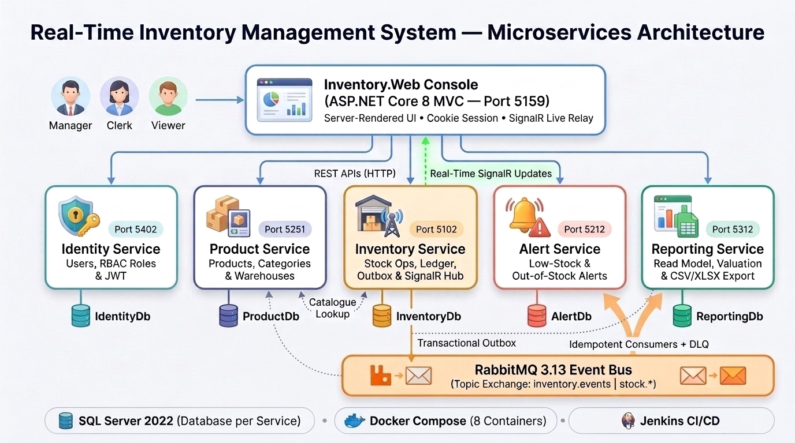
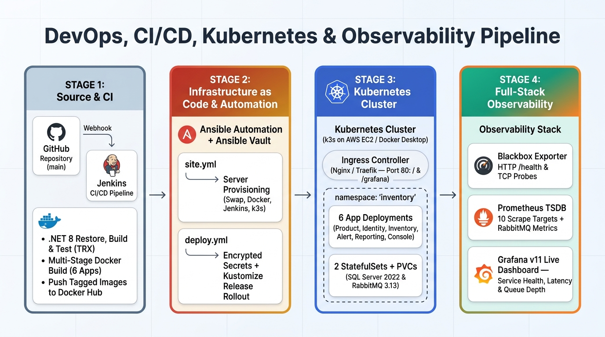

# Real-Time Inventory Management System

[](https://dotnet.microsoft.com/)
[](docker-compose.yml)
[](k8s/)
[](infra/ansible/)
[](Jenkinsfile)
[](monitoring/)

> **A cloud-native, event-driven microservices platform for real-time multi-warehouse stock tracking, automated low-stock alerting, financial valuation reporting, and full-stack DevOps observability.**
>
> **نبذة مختصرة:** نظام متكامل لإدارة ومراقبة المخزون في الوقت الفعلي عبر المستودعات المتعددة، مبني بمعمارية الخدمات المصغّرة (**ASP.NET Core 8 Microservices**) مع الربط غير المتزامن عبر **RabbitMQ** والتحديث الفوري عبر **SignalR**، ومجهّز بالكامل للنشر والمراقبة عبر **Docker**, **Kubernetes**, **Ansible**, **Jenkins CI/CD**, و **Grafana + Prometheus**.

---

## Table of Contents

1. [Project Name](#1-project-name)
2. [Project Idea](#2-project-idea)
3. [Instructor](#3-instructor)
4. [Team Members](#4-team-members)
5. [Roles & Responsibilities](#5-roles--responsibilities)
6. [Work Plan](#6-work-plan)
7. [Key Performance Indicators (KPIs)](#7-key-performance-indicators-kpis)
8. [Project Files & Deliverables](#8-project-files--deliverables)
9. [System Architecture & DevOps Pipeline](#9-system-architecture--devops-pipeline)
10. [Full Technology Stack](#10-full-technology-stack)
11. [Getting Started (Docker, Kubernetes & Local .NET)](#11-getting-started-docker-kubernetes--local-net)
12. [API Reference & Default Credentials](#12-api-reference--default-credentials)

---

## 1. Project Name

**Real-Time Inventory Management System**  
*(نظام إدارة المخزون في الوقت الفعلي)*

- **Official Repository:** <https://github.com/omarwae64/Real-Time-Inventory-Management-System>
- **Visibility:** Public

---

## 2. Project Idea

Organizations managing stock across multiple warehouses frequently suffer from **delayed visibility**, **stockouts**, **concurrent operator race conditions**, and **manual spreadsheet reconciliation**.

**The Idea:** Build a decoupled, fault-tolerant **Microservices Inventory Platform** where every service owns its isolated database (**Database-per-Service**) and communicates asynchronously via an event bus:
1. **Trusted Central Catalogue:** Manage products (`SKU`, unit price, minimum stock threshold), categories, and warehouses with **soft-delete** protection so historical ledgers never break.
2. **Auditable Stock Operations:** Execute **Receive**, **Issue**, **Warehouse-to-Warehouse Transfer**, and **Physical Count Adjustment** backed by an append-only ledger, **optimistic concurrency**, and the **Transactional Outbox Pattern** (zero lost events even during broker outages).
3. **Automated Low-Stock Alerting:** Project stock events via **RabbitMQ** into stateful `LOW_STOCK` and `OUT_OF_STOCK` alerts that automatically resolve upon replenishment without duplicate noise.
4. **Live Operational Console & Financial Reports:** Stream sub-second UI updates to connected browsers via **SignalR**, and generate filterable **Inventory**, **Low-Stock**, **Movement**, and **Valuation** reports exportable to **CSV** and native **Excel (`.xlsx`)**.
5. **Production-Grade DevOps & Observability:** Automate build, test, containerization, secret encryption, Kubernetes orchestration, and live metrics monitoring using **Jenkins**, **Docker**, **Ansible + Vault**, **Kubernetes (Kustomize / k3s)**, **Prometheus**, and **Grafana**.

---

## 3. Instructor

- **Instructor:** **Eng. Ahmed Gamil** *(م. أحمد جميل)*

---

## 4. Team Members

| # | Team Member | GitHub / Contact |
| :-: | :--- | :--- |
| 1 | **Omar Wael** | [@omarwae64](https://github.com/omarwae64) |
| 2 | **Ahmed Hassan** | Team Member |
| 3 | **Yossuf Yasser** | Team Member |
| 4 | **Karim** | Team Member |
| 5 | **Kotb** | Team Member |

---

## 5. Roles & Responsibilities

| Team Member | Primary Role | Key Responsibilities |
| :--- | :--- | :--- |
| **Omar Wael** | **DevOps, Kubernetes & Observability Lead** | Designed local & cloud **Kubernetes (`k8s` + Kustomize)** overlays, integrated **Ansible** playbooks on `main`, built full **Grafana + Prometheus + Blackbox** observability dashboards, validated E2E cluster rollouts, and prepared final repository & release deliverables. |
| **Ahmed Hassan** | **Solution Architect & Core Microservices Lead** | Architected Clean Architecture layers, implemented core `.NET 8` microservices (`Product`, `Inventory`, `Alert`, `Reporting`, `Identity`), **Transactional Outbox**, **SignalR** live hub, MVC Console, and base infrastructure manifests. |
| **Yossuf Yasser** | **CI/CD & Containerization Engineer** | Configured multi-stage **Docker** builds, `docker-compose` orchestration, **Jenkins CI/CD** pipeline automation, environment templates, and staging deployment workflows. |
| **Karim** | **Backend & Messaging Integration Developer** | Contributed to **RabbitMQ** event contracts, idempotent event consumers, dead-letter queue (`DLQ`) handling, read-model projections, and REST API validation/ProblemDetails error handling. |
| **Kotb** | **Frontend MVC, Reporting & QA Engineer** | Contributed to **ASP.NET Core MVC** Razor views, RBAC UI access policies, CSV/OpenXML `.xlsx` report verification, cross-service contract validation, and end-to-end functional testing. |

---

## 6. Work Plan

The project was delivered across **8 structured Agile sprints**, progressing from domain foundations to full Kubernetes orchestration and observability:

| Sprint | Phase | Scope & Key Deliverables | Status |
| :---: | :--- | :--- | :---: |
| **Sprint 1** | **Foundation & Architecture** | Solution structure (`19` projects), shared BuildingBlocks (`Contracts`, `Messaging`, `Security`), Docker SQL Server & RabbitMQ setup. | ✅ Done |
| **Sprint 2** | **Catalogue & Warehouses** | `Product.Api` (`ProductDb`), SKU invariants, Categories, Warehouses CRUD, EF Core SQL Server migrations & seeding. | ✅ Done |
| **Sprint 3** | **Inventory & Concurrency** | `Inventory.Api` (`InventoryDb`), Receive / Issue / Transfer / Adjust operations, append-only ledger, optimistic concurrency (`409`), Transactional Outbox. | ✅ Done |
| **Sprint 4** | **Event Bus & Alerting** | RabbitMQ topic exchange (`inventory.events`), `Alert.Api` (`AlertDb`), idempotent consumers, DLQ (`*.dead`), auto-raise & auto-resolve low-stock alerts. | ✅ Done |
| **Sprint 5** | **CQRS Read Model & Reporting** | `Reporting.Api` (`ReportingDb`), event projections, Inventory / Low-Stock / Movement / Valuation reports, native `.xlsx` & `.csv` exporters. | ✅ Done |
| **Sprint 6** | **Web Console (MVC UI)** | `Inventory.Web` server-rendered Razor console, progressive enhancement, resilient service-outage handling (`503` banners). | ✅ Done |
| **Sprint 7** | **Identity, RBAC & Live SignalR** | `Identity.Api` (`IdentityDb`), JWT signing & scopes, `Manager` / `Clerk` / `Viewer` roles, Cookie sessions, `StockHub` + `StockRelay` live browser updates. | ✅ Done |
| **Sprint 8** | **DevOps, CI/CD, K8s & Observability** | Unified `Dockerfile`, `Jenkinsfile` pipeline, **Ansible + Vault** IaC (`site.yml`, `deploy.yml`), **Kubernetes** (`base`, `local`, `dev`, `prod` overlays), and **Grafana + Prometheus** live monitoring. | ✅ Done |

---

## 7. Key Performance Indicators (KPIs)

All KPIs below were empirically measured and verified during build, integration, Docker Compose, and live Kubernetes cluster testing:

| KPI Category | Metric | Target | Achieved Result |
| :--- | :--- | :---: | :---: |
| **Build Quality** | Solution compilation errors & warnings (`Release` mode) | `0` | **`0 Errors / 0 Warnings`** |
| **Automated Testing** | Unit, HTTP integration & cross-service contract tests | `> 300` | **`442 Passing Tests`** |
| **Event Reliability** | Lost or duplicated stock events under broker restart | `0%` | **`0% Loss / 0 Duplicates`** *(Outbox + Idempotency)* |
| **Dead-Letter Health** | Poison / unhandled messages in `*.inventory.dead` queues | `0` | **`0 Messages`** |
| **API & Probe Latency** | Microservice `/health` & `/sign-in` HTTP response time | `< 100 ms` | **`8 – 35 ms`** *(verified via Blackbox/Prometheus)* |
| **Real-Time UI Sync** | End-to-end SignalR stock update propagation to browsers | `< 1.5 s` | **`< 1 second`** |
| **Cluster Readiness** | Kubernetes pods & PVCs healthy in `inventory` namespace | `100%` | **`11 / 11 Pods Running` (`0 Restarts`)** |
| **Observability Coverage** | Active Prometheus scrape targets (`HTTP`, `TCP`, `RabbitMQ`) | `100%` | **`10 / 10 Targets UP` + `14-Panel Grafana Dashboard`** |

---

## 8. Project Files & Deliverables

All source code, infrastructure-as-code, documentation, and presentation files are hosted directly inside this repository:

| Deliverable | Repository Path | Description |
| :--- | :--- | :--- |
| **📊 Project Presentation (`.pptx`)** | [`docs/Real-Time-Inventory-System-Presentation.pptx`](docs/Real-Time-Inventory-System-Presentation.pptx) | Executive slide deck covering architecture, features, DevOps, Kubernetes, Grafana & KPIs (with Arabic speaker notes). |
| **📘 Full Technical Documentation (`.docx`)** | [`Documentation.docx`](Documentation.docx) | Comprehensive Word specification covering microservices, APIs, database schemas, CI/CD, Ansible, Kubernetes & Observability. |
| **🖼️ Microservices Architecture Diagram** | [`docs/architecture-diagram.jpg`](docs/architecture-diagram.jpg) | High-resolution illustrated microservices & event-bus architecture infographic. |
| **🖼️ DevOps & Kubernetes Pipeline Diagram** | [`docs/devops-pipeline-diagram.jpg`](docs/devops-pipeline-diagram.jpg) | High-resolution CI/CD, Ansible, Kubernetes & Grafana observability pipeline diagram. |
| **💻 Core Source Code (`.NET 8`)** | [`src/`](src/) & [`InventorySystem.sln`](InventorySystem.sln) | `BuildingBlocks`, 5 Microservices (`Product`, `Identity`, `Inventory`, `Alert`, `Reporting`), and `Inventory.Web` MVC Console. |
| **🐳 Docker Configuration** | [`Dockerfile`](Dockerfile), [`docker-compose.yml`](docker-compose.yml), [`.env.example`](.env.example) | Multi-stage container build and 11-container local stack (SQL Server + RabbitMQ + 6 Apps + Monitoring). |
| **☸️ Kubernetes Manifests (`Kustomize`)** | [`k8s/base/`](k8s/base/) & [`k8s/overlays/`](k8s/overlays/) | Base manifests + `local` (Docker Desktop / Nginx), `dev`, and `prod` (AWS k3s / Traefik) overlays. |
| **⚙️ Ansible Automation & Vault** | [`infra/ansible/`](infra/ansible/) | `site.yml` (EC2 provisioning: Swap, Docker, Jenkins, k3s) & `deploy.yml` (zero-downtime Kustomize release rollout). |
| **🔁 CI/CD Pipeline** | [`Jenkinsfile`](Jenkinsfile) | Automated Restore → Build → Test (`.trx`) → Docker Build/Push → Ansible Dev Deploy → Manual Approval → Prod Deploy. |
| **📈 Grafana & Prometheus Stack** | [`monitoring/`](monitoring/) | Auto-provisioned Prometheus datasource, Blackbox HTTP/TCP probes, and 14-panel `inventory-overview.json` Grafana dashboard. |
| **📚 Engineering Guides** | [`docs/`](docs/) | Detailed guides: [`architecture.md`](docs/architecture.md), [`development.md`](docs/development.md), [`deployment.md`](docs/deployment.md), [`api.md`](docs/api.md), [`web-ui.md`](docs/web-ui.md). |

---

## 9. System Architecture & DevOps Pipeline

### 9.1 Microservices & Event-Driven Architecture



- **Database-per-Service:** Every backend microservice owns its dedicated SQL Server database (`ProductDb`, `IdentityDb`, `InventoryDb`, `AlertDb`, `ReportingDb`). Cross-service data flows exclusively through **REST APIs** or **RabbitMQ integration events**.
- **Transactional Outbox + Idempotent Consumers:** `Inventory.Api` commits stock mutations, ledger entries, and `OutboxMessages` atomically in a single database transaction. A background dispatcher publishes events (`stock.received`, `stock.issued`, `stock.transferred`, `stock.adjusted`) to RabbitMQ (`inventory.events`), where `Alert.Api` and `Reporting.Api` deduplicate by `EventId` and isolate poison messages in `*.inventory.dead` queues.
- **Clean Layered Structure:** Each service is separated into `Domain` → `Application` → `Infrastructure` → `Api`.

### 9.2 DevOps, CI/CD, Kubernetes & Observability Pipeline



---

## 10. Full Technology Stack

| Layer | Technologies |
| :--- | :--- |
| **Backend & APIs** | C# 12, .NET 8, ASP.NET Core 8 Web API, Entity Framework Core 8, Swashbuckle (Swagger/OpenAPI), RFC 7807 ProblemDetails |
| **Frontend Console** | ASP.NET Core 8 MVC (Razor Views), SignalR Client & Server Relay, Progressive Enhancement CSS/JS |
| **Databases** | Microsoft SQL Server 2022 (Primary, 5 isolated databases), SQLite (Local zero-container fallback) |
| **Messaging & Real-Time** | RabbitMQ 3.13 (AMQP Topic Exchange, Publisher Confirms, DLQ), ASP.NET Core SignalR WebSockets |
| **Security** | JWT Bearer Authentication (`HS256` + Scopes), Server-Side Cookie Sessions, RBAC (`Manager`, `Clerk`, `Viewer`, `Service`), Ansible Vault |
| **Containers & Orchestration** | Docker (Multi-Stage Build), Docker Compose, Kubernetes (`k3s` & Docker Desktop), Kustomize (`base`, `local`, `dev`, `prod`), Nginx & Traefik Ingress |
| **CI/CD & IaC** | Jenkins Declarative Pipeline (`Jenkinsfile`), Ansible (`site.yml`, `deploy.yml`, Jinja2 templates), AWS EC2 (Ubuntu 24.04 LTS) |
| **Observability** | Grafana 11.2 (Auto-provisioned Home Dashboard), Prometheus 2.54, Blackbox Exporter 0.25, RabbitMQ Prometheus Plugin (`:15692`) |

---

## 11. Getting Started (Docker, Kubernetes & Local .NET)

### Option A — Run Everything with Docker Compose (Includes Grafana)

```bash
cp .env.example .env
docker compose up -d --build
docker compose ps   # Wait until all 11 containers report (healthy)
```

- **Web Console:** <http://localhost:5159> (`manager` / `inventory-console-2026`)
- **Grafana Dashboard:** <http://localhost:3000> (`admin` / `inventory-grafana-2026`)
- **Prometheus UI:** <http://localhost:9091>
- **RabbitMQ Management:** <http://localhost:15672> (`inventory` / `inventory`)

### Option B — Deploy on Local Kubernetes (Docker Desktop / `ingress-nginx`)

```bash
# 1. Build the 6 local microservice images once
cp .env.example .env
docker compose build

# 2. Deploy all 11 pods (SQL Server, RabbitMQ, 6 Apps, Blackbox, Prometheus, Grafana + Ingress)
kubectl apply -k k8s/overlays/local

# 3. Verify all pods are 1/1 Running
kubectl -n inventory get pods,pvc,ingress
```

- **Web Console (via Ingress):** <http://localhost/> (`manager` / `inventory-console-2026`)
- **Grafana Live Dashboard (via Ingress):** <http://localhost/grafana> (`admin` / `inventory-grafana-2026`)

### Option C — Cloud Deployment (AWS EC2 + Ansible + Jenkins + k3s)

Full step-by-step cloud provisioning and automated release instructions are documented in [`docs/deployment.md`](docs/deployment.md):

```bash
cd infra/ansible
export ANSIBLE_CONFIG=$PWD/ansible.cfg
ansible-playbook site.yml --private-key ~/.ssh/inventory-key.pem
ansible-playbook deploy.yml -l dev -e image_tag=<build-sha> --ask-vault-pass
```

### Option D — Run Directly via `.NET CLI` (SQLite Fallback)

```bash
dotnet build InventorySystem.sln

# Run each service in its own terminal (falls back to local SQLite automatically in Development):
dotnet run --project src/Services/Product/Product.Api       # http://localhost:5251/swagger
dotnet run --project src/Services/Identity/Identity.Api     # http://localhost:5402/swagger
dotnet run --project src/Services/Inventory/Inventory.Api   # http://localhost:5102/swagger
dotnet run --project src/Services/Alert/Alert.Api           # http://localhost:5212/swagger
dotnet run --project src/Services/Reporting/Reporting.Api   # http://localhost:5312/swagger
dotnet run --project src/Inventory.Web                      # http://localhost:5159
```

---

## 12. API Reference & Default Credentials

### Default Development Accounts

| System | URL (Docker / K8s) | Username(s) | Password |
| :--- | :--- | :--- | :--- |
| **Inventory Web Console** | `http://localhost:5159` or `http://localhost/` | `manager`, `clerk`, `viewer` | `inventory-console-2026` |
| **Grafana Observability** | `http://localhost:3000` or `http://localhost/grafana` | `admin` | `inventory-grafana-2026` |
| **RabbitMQ Management** | `http://localhost:15672` | `inventory` | `inventory` |

### Microservice Endpoints Overview

| Service | Dev Port | Database | Core Endpoints |
| :--- | :---: | :---: | :--- |
| **Product API** | `5251` | `ProductDb` | `GET/POST/PUT/DELETE /api/products`, `/api/categories`, `/api/warehouses`, `GET /health` |
| **Identity API** | `5402` | `IdentityDb` | `POST /api/auth/token`, `GET /api/auth/me`, `GET /api/users`, `GET /health` |
| **Inventory API** | `5102` | `InventoryDb` | `GET /api/inventory`, `/api/inventory/history`, `POST /receive`, `/issue`, `/transfer`, `/adjust`, SignalR `/hubs/stock` |
| **Alert API** | `5212` | `AlertDb` | `GET /api/alerts`, `GET /api/alerts/{id}`, `PUT /api/alerts/{id}/read`, `GET /health` |
| **Reporting API** | `5312` | `ReportingDb` | `GET /api/reports/{inventory\|low-stock\|movement\|valuation}`, `GET /api/reports/{report}/export?format=csv\|xlsx` |
| **Web Console** | `5159` | *(Stateless)* | `/`, `/sign-in`, `/products`, `/categories`, `/warehouses`, `/inventory/*`, `/alerts`, `/reports/*`, SignalR `/hubs/live` |
