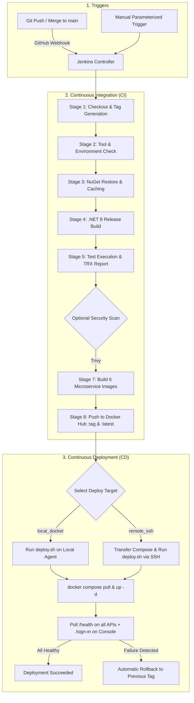

# Jenkins CI/CD Pipeline: Architecture, Implementation, and Usage Guide

A comprehensive reference for the Continuous Integration and Continuous Deployment (CI/CD) pipeline built with **Jenkins**, **Docker**, **Docker Compose**, and **.NET 8** for the Inventory System Microservices.

---

## Table of Contents

1. [Architecture & Workflow Overview](#1-architecture--workflow-overview)
2. [CI/CD File Structure](#2-cicd-file-structure)
3. [Deep Dive: Pipeline Stages (`Jenkinsfile`)](#3-deep-dive-pipeline-stages-jenkinsfile)
4. [Setting Up Jenkins](#4-setting-up-jenkins)
5. [Configuring Jenkins Credentials](#5-configuring-jenkins-credentials)
6. [Configuring GitHub Webhooks](#6-configuring-github-webhooks)
7. [How to Run and Use the Pipeline](#7-how-to-run-and-use-the-pipeline)
8. [Deployment, Health Checks, and Automated Rollback](#8-deployment-health-checks-and-automated-rollback)
9. [Troubleshooting & Common Issues](#9-troubleshooting--common-issues)

---

## 1. Architecture & Workflow Overview

The CI/CD pipeline automates the entire software lifecycle: from code commit on GitHub to production deployment with zero downtime and automated health verification.



### Microservices Built and Published by the Pipeline

| Service Name | Docker Hub Repository | Internal Port | Host Port | Health Check Endpoint |
|---|---|:---:|:---:|---|
| **Product API** | `${DOCKERHUB_USERNAME}/inventory-product-api` | `8080` | `5251` | `http://localhost:5251/health` |
| **Identity API** | `${DOCKERHUB_USERNAME}/inventory-identity-api` | `8080` | `5402` | `http://localhost:5402/health` |
| **Inventory API** | `${DOCKERHUB_USERNAME}/inventory-inventory-api` | `8080` | `5102` | `http://localhost:5102/health` |
| **Alert API** | `${DOCKERHUB_USERNAME}/inventory-alert-api` | `8080` | `5212` | `http://localhost:5212/health` |
| **Reporting API** | `${DOCKERHUB_USERNAME}/inventory-reporting-api` | `8080` | `5312` | `http://localhost:5312/health` |
| **Web Console (MVC)** | `${DOCKERHUB_USERNAME}/inventory-console` | `8080` | `5159` | `http://localhost:5159/sign-in` |

---

## 2. CI/CD File Structure

The project includes purpose-built files for CI/CD:

```
Inventory_System_Project/
├── Jenkinsfile                      # Main Declarative Jenkins CI/CD Pipeline
├── docker-compose.yml               # Dev & Multi-stage container build definition
├── docker-compose.prod.yml          # Production runtime (pulls pre-built images from Docker Hub)
├── .env.example                     # Production environment variable template
├── deploy/
│   ├── deploy.sh                    # Deployment automation script with health probing & rollback
│   └── docker-compose.jenkins.yml   # Ready-to-run containerized Jenkins setup
└── docs/
    └── ci-cd-jenkins-guide.md       # This complete documentation guide
```

---

## 3. Deep Dive: Pipeline Stages (`Jenkinsfile`)

[`Jenkinsfile`](file:///e:/projects/Inventory_System_Project/Inventory_System_Project-main/Jenkinsfile) is written using **Jenkins Declarative Pipeline** syntax. Below is an explanation of every configuration block and stage.

### Pipeline Parameters

When triggering manual builds (**Build with Parameters** in Jenkins), the following options are available:

* **`DEPLOY_ENVIRONMENT`** (`choice`: `staging`, `production`, `none`):
  Specifies the target deployment environment. Defaults to `staging`.
* **`PUSH_IMAGES`** (`booleanParam`):
  When checked, pushes images to Docker Hub. Automatically active on the `main` branch.
* **`DEPLOY_MODE`** (`choice`: `local_docker`, `remote_ssh`, `none`):
  Controls where the deployment runs.
  * `local_docker`: Deploys directly onto the Docker host running the Jenkins agent.
  * `remote_ssh`: Deploys to a remote server over SSH.
  * `none`: Skips the deployment stage (CI-only run).
* **`REMOTE_DEPLOY_HOST`** (`string`):
  SSH user and hostname for remote deployments (e.g. `ubuntu@192.168.1.100`).
* **`REMOTE_DEPLOY_DIR`** (`string`):
  Remote directory where the application is hosted (e.g. `/opt/inventory-system`).
* **`RUN_SECURITY_SCAN`** (`booleanParam`):
  Runs a Trivy container security vulnerability scanner during the build when enabled.

---

### Stage-by-Stage Breakdown

#### Stage 1: Checkout & Metadata
* Pulls source code from Git.
* Extracts the short commit hash (`git rev-parse --short=8 HEAD`).
* Generates an **immutable Docker tag**:
  $$\text{IMAGE\_TAG} = \text{BUILD\_NUMBER} - \text{GIT\_SHORT\_SHA}$$
  *Example*: `42-c843bd6d`. This guarantees traceable, non-overwriting releases.

#### Stage 2: Tool & Environment Verification
* Validates that `docker`, `docker compose`, and `.NET SDK` are available.
* **Smart Container Fallback**: If the host Jenkins agent does not have `.NET SDK 8.0` installed, the pipeline automatically routes build and test tasks through the official `mcr.microsoft.com/dotnet/sdk:8.0` container.

#### Stage 3: Restore Dependencies
* Restores all NuGet packages required by `InventorySystem.sln`.
* When running in container fallback mode, mounts a persistent Docker volume (`jenkins-nuget-cache:/root/.nuget/packages`) to preserve downloaded packages across builds.

#### Stage 4: Build .NET Solution
* Compiles the 23 microservices, domain libraries, and building blocks using `dotnet build InventorySystem.sln --configuration Release`.
* Prevents re-downloading packages by reusing the restored cache.

#### Stage 5: Test Execution & Archival
* Runs all test suites with:
  ```bash
  dotnet test InventorySystem.sln --configuration Release --no-build \
      --logger "trx;LogFilePrefix=results" --results-directory TestResults
  ```
* Archives `.trx` test report files so Jenkins can visualize test trends and failed assertions in the build summary.

#### Stage 6: Security & Vulnerability Scan (Optional)
* Activated when `RUN_SECURITY_SCAN` is set to `true`.
* Runs an automated Trivy security scanner against the repository to flag High and Critical CVE vulnerabilities in dependencies and configuration files.

#### Stage 7: Build Docker Images
* Builds all 6 application images using the multi-stage [`Dockerfile`](file:///e:/projects/Inventory_System_Project/Inventory_System_Project-main/Dockerfile) and [`docker-compose.yml`](file:///e:/projects/Inventory_System_Project/Inventory_System_Project-main/docker-compose.yml):
  * `product-api`
  * `identity-api`
  * `inventory-api`
  * `alert-api`
  * `reporting-api`
  * `console`
* Uses multi-stage Docker builds to ensure runtime images contain **only compiled binaries**, keeping images lightweight and secure.

#### Stage 8: Push Docker Images
* Authenticates to Docker Hub using the Jenkins credential `dockerhub-credentials`.
* Pushes the immutable tag `${DOCKERHUB_USERNAME}/inventory-<service>:${IMAGE_TAG}`.
* Tags and pushes `${DOCKERHUB_USERNAME}/inventory-<service>:latest`.
* Always runs `docker logout` in a `post` step to prevent credential leakage on the agent.

#### Stage 9: Continuous Deployment (CD)
* Triggers automatically when building `main` or upon manual deployment selection.
* **Local Mode (`local_docker`)**:
  Prepares `.env`, sets `IMAGE_TAG`, and invokes [`deploy/deploy.sh`](file:///e:/projects/Inventory_System_Project/Inventory_System_Project-main/deploy/deploy.sh) directly.
* **Remote Mode (`remote_ssh`)**:
  Uses SSH agent credentials (`deploy-ssh-key`), copies [`docker-compose.prod.yml`](file:///e:/projects/Inventory_System_Project/Inventory_System_Project-main/docker-compose.prod.yml) and [`deploy/deploy.sh`](file:///e:/projects/Inventory_System_Project/Inventory_System_Project-main/deploy/deploy.sh) to the remote target via `scp`, and executes the deployment over SSH.

#### Post Actions
* **Cleanup**: Cleans up dangling intermediate Docker images using `docker image prune -f`.
* **Notifications**: Logs pipeline completion status and tags.

---

## 4. Setting Up Jenkins

If you do not have a running Jenkins instance, use the provided Docker Compose configuration.

### 1. Launch Jenkins Container
From the repository root:
```bash
docker compose -f deploy/docker-compose.jenkins.yml up -d
```

### 2. Retrieve Initial Admin Password
```bash
docker exec -it jenkins-ci cat /var/jenkins_home/secrets/initialAdminPassword
```

### 3. Complete Initial Setup
1. Open your browser to `http://localhost:8080`.
2. Paste the admin password.
3. Select **"Install suggested plugins"**.
4. Create your admin user account and save the Jenkins URL (`http://localhost:8080`).

### 4. Install Required Plugins
Navigate to **Manage Jenkins** > **Plugins** > **Available plugins**, search for and install:
1. **Docker Pipeline** (`docker-workflow`)
2. **GitHub Integration** (`github`)
3. **Pipeline: Stage View** (`pipeline-stage-view`)
4. **SSH Agent Plugin** (`ssh-agent`) *(Required if using remote deployment)*
5. **Credentials Binding Plugin** (`credentials-binding`)

Restart Jenkins if prompted after installation.

---

## 5. Configuring Jenkins Credentials

The pipeline relies on credentials stored securely inside Jenkins.

Navigate to:
**Manage Jenkins** > **Credentials** > **System** > **Global credentials (unrestricted)** > **Add Credentials**.

### Credential 1: Docker Hub Access (`dockerhub-credentials`)
* **Kind**: `Username with password`
* **Scope**: `Global`
* **Username**: Your Docker Hub username (e.g., `ahmedheroo`)
* **Password**: Your Docker Hub Personal Access Token (PAT) (recommended over account password)
* **ID**: `dockerhub-credentials` *(Must match exactly)*
* **Description**: `Docker Hub Registry Credentials`

### Credential 2: SSH Deploy Key (`deploy-ssh-key`) *(Optional for remote SSH)*
* **Kind**: `SSH Username with private key`
* **Scope**: `Global`
* **ID**: `deploy-ssh-key` *(Must match exactly)*
* **Username**: The SSH username on the remote server (e.g. `ubuntu` or `deploy`)
* **Private Key**: Select **Enter directly** and paste your private key (`id_rsa` or `id_ed25519`)
* **Description**: `Production Deployment Server SSH Key`

---

## 6. Configuring GitHub Webhooks

To trigger the pipeline automatically whenever code is pushed to GitHub:

### 1. Configure Webhook on GitHub
1. Open your GitHub repository in your browser: `https://github.com/ahmedheroo/Inventory_System_Project`.
2. Go to **Settings** > **Webhooks** > **Add webhook**.
3. **Payload URL**:
   ```
   http://<YOUR_JENKINS_SERVER_IP>:8080/github-webhook/
   ```
   *(Note the trailing slash)*
4. **Content type**: Select `application/json`.
5. **Which events would you like to trigger this webhook?**:
   * Select **Just the push event** (or select individual events including Pull Requests).
6. Ensure **Active** is checked and click **Add webhook**.

---

## 7. How to Run and Use the Pipeline

### Creating the Pipeline Job in Jenkins

1. On the Jenkins dashboard, click **New Item**.
2. Enter item name: `Inventory-System-CI-CD`.
3. Select **Pipeline** and click **OK**.
4. Under **Build Triggers**:
   * Check **GitHub hook trigger for GITScm polling**.
5. Under **Pipeline**:
   * **Definition**: `Pipeline script from SCM`
   * **SCM**: `Git`
   * **Repository URL**: `https://github.com/ahmedheroo/Inventory_System_Project.git`
   * **Branch Specifier**: `*/main`
   * **Script Path**: `Jenkinsfile`
6. Click **Save**.

---

### Executing Builds

#### Approach A: Automated Trigger
Push any commit to GitHub:
```bash
git add .
git commit -m "feat: updated product catalog"
git push origin main
```
The GitHub webhook sends an HTTP POST event to Jenkins, which starts the pipeline automatically.

#### Approach B: Manual Execution
1. Navigate to your job in Jenkins (`Inventory-System-CI-CD`).
2. Click **Build with Parameters** in the left menu.
3. Select:
   * **DEPLOY_ENVIRONMENT**: `staging` or `production`
   * **PUSH_IMAGES**: Checked (`true`)
   * **DEPLOY_MODE**: `local_docker` or `remote_ssh`
4. Click **Build**.
5. Monitor progress live via the **Stage View** dashboard.

---

## 8. Deployment, Health Checks, and Automated Rollback

### Production Architecture (`docker-compose.prod.yml`)

In production, source code is **never** compiled on the host. Instead, [`docker-compose.prod.yml`](file:///e:/projects/Inventory_System_Project/Inventory_System_Project-main/docker-compose.prod.yml) pulls tested, immutable container images directly from Docker Hub.

Key characteristics:
* Environment set to `Production`.
* Enforces strict presence of secrets (`MSSQL_SA_PASSWORD`, `JWT_SIGNING_KEY`, `RABBITMQ_PASSWORD`).
* `restart: always` on all services.
* Persistent volume storage for SQL Server (`sqlserver-prod-data`) and RabbitMQ (`rabbitmq-prod-data`).

---

### Automated Deployment Script (`deploy/deploy.sh`)

[`deploy/deploy.sh`](file:///e:/projects/Inventory_System_Project/Inventory_System_Project-main/deploy/deploy.sh) manages zero-downtime updates:

1. **Loads environment variables** from `.env`.
2. **Pulls updated container images** with `docker compose -f docker-compose.prod.yml pull`.
3. **Recreates updated services** with `docker compose -f docker-compose.prod.yml up -d --remove-orphans`.
4. **Executes health check polling loop**:
   * Pings each API's `/health` endpoint up to 20 times (every 5 seconds).
   * Pings the Web Console sign-in screen at `/sign-in`.
5. **Automated Rollback**:
   * If any service fails to return HTTP 200 within 100 seconds:
     * Halts deployment immediately.
     * Restores `IMAGE_TAG` to `PREV_IMAGE_TAG`.
     * Runs `docker compose up -d` to revert to the previous working containers.
     * Exits with code `1`, causing Jenkins to mark the build as failed.

---

## 9. Troubleshooting & Common Issues

### 1. Docker Permission Denied on Jenkins Agent
* **Symptom**: `permission denied while trying to connect to the docker API at npipe:////./pipe/docker_engine` or `/var/run/docker.sock`.
* **Fix**: Ensure the Jenkins container has root privileges or that the `jenkins` user is added to the `docker` group (`sudo usermod -aG docker jenkins`). When running with `deploy/docker-compose.jenkins.yml`, `user: root` is pre-configured.

### 2. GPG Overwrite Prompt on Jenkins Restart
* **Symptom**: `gpg: cannot open '/dev/tty': No such device or address` causing Jenkins container to loop restart.
* **Fix**: Add `--yes` to the `gpg --dearmor` command and verify `docker` binary existence before apt installation. This fix is already included in [`deploy/docker-compose.jenkins.yml`](file:///e:/projects/Inventory_System_Project/Inventory_System_Project-main/deploy/docker-compose.jenkins.yml).

### 3. Docker Hub Image Reference Formatting Error
* **Symptom**: `invalid tag "/inventory-product-api:1.0.0": invalid reference format`.
* **Fix**: This happens if `DOCKERHUB_USERNAME` is empty. The compose files include a safe default fallback: `${DOCKERHUB_USERNAME:-inventory}/inventory-...`.

### 4. NuGet Restore Missing in Multi-Container Builds
* **Symptom**: `error NETSDK1064: Package ... was not found. It might have been deleted since NuGet restore`.
* **Fix**: When using container fallback mode for .NET SDK, stages mount a persistent volume (`-v jenkins-nuget-cache:/root/.nuget/packages`) so downloaded dependencies persist across build and test stages.

### 5. Webhook Not Reaching Local Jenkins
* **Symptom**: GitHub webhook shows red warning / timeout.
* **Fix**: If Jenkins runs on a local machine behind NAT/firewall, GitHub cannot reach private IPs (`192.168.x.x` or `localhost`). Use a tunneling tool like **ngrok** or **Cloudflare Tunnel**:
  ```bash
  ngrok http 8080
  ```
  Then use the public forwarding URL in GitHub Webhook settings: `https://<unique-subdomain>.ngrok-free.app/github-webhook/`.
